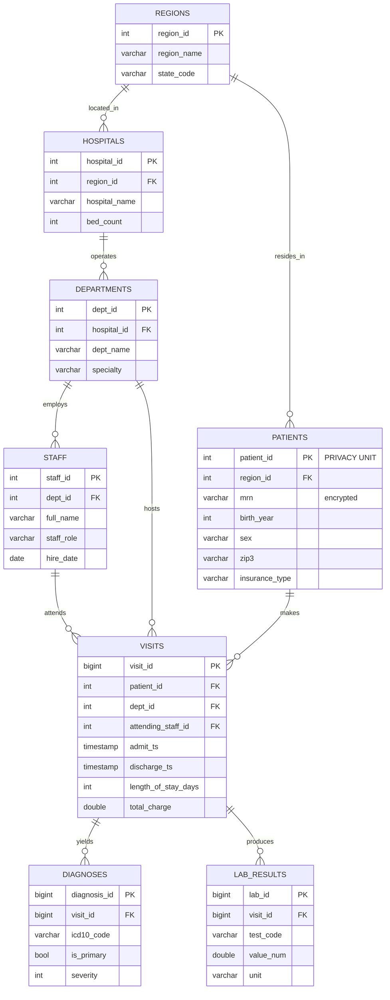

# PrivGuard
### A Differentially Private Query Execution Engine with Budget-Aware Storage Semantics
**Full technical specification, schema, ER model, and 14-week implementation plan**

---

## 0. Scoping Reality Check (read this first)

| Component | Verdict | Reason |
|---|---|---|
| Page-based storage + buffer pool + heap files | **CORE** | Feasible in ~2 weeks, it's the heart of a DB course project |
| B+ tree index | **CORE** | Standard, well-documented, you need it for the paper |
| SQL parser → logical plan → Volcano executor | **CORE** | Use a parser *crate*, don't hand-write a SQL grammar |
| DP aggregate operator inside the plan | **CORE — this is your novelty** | The whole point of the project |
| Contribution bounding operator | **CORE** | Without it your DP guarantee is *false*. Non-negotiable. |
| Privacy budget ledger (hash-chained, WAL-style) | **CORE — your second novelty** | Cheap to build, great paper framing |
| Query fingerprinting + noise memoization | **CORE** | ~300 lines, defeats the averaging attack, big demo win |
| DP partition selection for GROUP BY | **CORE** | Most projects miss this; it's a real leak |
| Role-based column policy (raw / dp / redacted / denied) | **CORE** | Simple catalog lookup at plan time |
| Full CP-ABE cryptographic access control | **STRETCH** | Use `rabe` crate, or degrade to envelope encryption |
| WAL + crash recovery (ARIES-lite) | **STRETCH** | Only redo, no undo, if time permits |
| Transactions / MVCC | **CUT** | Explicitly out of scope; state this in the paper |
| Joins across privacy units | **CUT (hard research problem)** | Support only star-schema joins to dimension tables |

> **Rule of thumb:** a working Core with an honest evaluation section beats a half-broken Full system. Every cut item becomes a "Future Work" bullet.

---

## 1. Technology Stack

### 1.1 Decision table

| Layer | Recommendation | Alternative | Why |
|---|---|---|---|
| **Engine core** | **Rust (2021 edition)** | C++20 | `sqlparser` crate gives you a full SQL AST free; `rand_distr` gives Laplace/Gaussian; `PyO3` gives Python bindings; borrow checker eliminates the buffer-pool use-after-free bugs that kill C++ student projects |
| **Reference DP oracle** | **Python 3.11 + NumPy + SciPy** | — | You write the DP math twice: once in Python (readable, testable, plots for the paper) and once in Rust (fast). Differential tests between them catch bugs. |
| **SQL parsing** | `sqlparser-rs` (Apache DataFusion's parser) | hand-written recursive descent | Don't spend 2 weeks on a lexer. Course credit is for *execution*, not parsing. |
| **Wire protocol** | **PostgreSQL wire protocol v3** via `pgwire` crate | custom length-prefixed binary over TCP | Instantly lets `psql`, `psycopg2`, DBeaver connect to *your* engine. Massive demo value. |
| **Python connector** | Custom **PEP 249 (DB-API 2.0)** driver wrapping `psycopg2`-style handshake | `PyO3` in-process bindings | Standards compliance is a paper talking point |
| **Backend API** | **FastAPI** (Python 3.11) + Uvicorn + Pydantic v2 | Axum (Rust) | You already know Python; async, auto OpenAPI docs, fast to build |
| **Auth** | JWT (`python-jose`) + `argon2-cffi` password hashing | session cookies | Analyst identity must bind to a budget account |
| **Frontend** | **React 18 + Vite + TypeScript + TailwindCSS** | Streamlit (if very short on time) | Recharts for budget burn-down charts, Monaco Editor for the SQL console |
| **Charts** | Recharts + `react-flow` for plan-tree visualisation | D3 | Showing the physical plan with the `DPAggregate` node highlighted is the best slide in your demo |
| **Catalog storage** | **Self-hosted inside PrivGuard** (bootstrapped system tables) | SQLite for v1 | Self-hosting the catalog is how Postgres/SQLite do it — a strong point for a DB course. Start on SQLite in Week 3, migrate in Week 7. |
| **Crypto** | `ring` / `aes-gcm` crate (envelope), `rabe` crate (CP-ABE, stretch) | libsodium | |
| **Benchmarking** | `criterion` (Rust), `pytest-benchmark`, custom harness | JMH-style | |
| **Testing** | `cargo test`, `proptest` (property-based), `pytest`, `hypothesis` | — | Property tests on the B+ tree are how you find the split bug |
| **CI** | GitHub Actions: `cargo clippy` + `cargo test` + `pytest` + coverage | — | You already run GH Actions on another repo; reuse the pattern |
| **Containerisation** | Docker Compose: `privguard-engine`, `privguard-api`, `privguard-ui` | bare metal | One-command demo for your evaluators |
| **Paper** | LaTeX, ACM `sigconf` template, Overleaf | — | |
| **Diagrams** | Mermaid (ER, in this doc) + draw.io / Excalidraw for architecture | — | |

### 1.2 Rust crate manifest (engine)

```toml
[dependencies]
sqlparser      = "0.45"    # SQL -> AST
pgwire         = "0.20"    # PostgreSQL wire protocol server
tokio          = { version = "1", features = ["full"] }
rand           = "0.8"
rand_distr     = "0.4"     # Laplace, Normal
rand_chacha    = "0.3"     # deterministic, seedable CSPRNG for noise memoization
getrandom      = "0.2"     # OS entropy for real deployments
serde          = { version = "1", features = ["derive"] }
serde_json     = "1"
bincode        = "1.3"     # page/tuple serialization
thiserror      = "1"
tracing        = "0.1"     # structured logging -> query audit
blake3         = "1.5"     # ledger hash chain
aes-gcm        = "0.10"    # column envelope encryption
argon2         = "0.5"
statrs         = "0.16"    # for zCDP <-> (eps,delta) conversion
rug            = "1.24"    # optional: exact arithmetic for the snapping mechanism
parking_lot    = "0.12"    # buffer pool latches

[dev-dependencies]
proptest       = "1"
criterion      = "0.5"
```

### 1.3 Python side

```
fastapi==0.111    uvicorn[standard]==0.30    pydantic==2.7
psycopg[binary]==3.1          # talks to your engine over pg wire
numpy==1.26  scipy==1.13  pandas==2.2  matplotlib==3.8
python-jose[cryptography]  argon2-cffi
pytest  pytest-benchmark  hypothesis
```

---

## 2. System Architecture

```
┌──────────────────────────────────────────────────────────────────────┐
│  FRONTEND  — React + Vite + TS + Tailwind                            │
│  · SQL console (Monaco)    · Budget burn-down chart (Recharts)       │
│  · Plan-tree viewer        · Policy admin  · Attack-demo panel       │
└───────────────────────────────┬──────────────────────────────────────┘
                                │ HTTPS / JSON (JWT bearer)
┌───────────────────────────────▼──────────────────────────────────────┐
│  BACKEND API — FastAPI                                               │
│  · AuthN (JWT)  · request shaping  · budget dashboards  · audit view │
└───────────────────────────────┬──────────────────────────────────────┘
                                │ PostgreSQL wire protocol v3 (psycopg3)
┌───────────────────────────────▼──────────────────────────────────────┐
│  PRIVGUARD ENGINE  (Rust)                                            │
│                                                                      │
│  ┌────────────┐  ┌──────────────┐  ┌───────────────┐  ┌───────────┐ │
│  │ Wire/Proto │→ │ Parser (AST) │→ │ Binder+Catalog│→ │ Logical   │ │
│  └────────────┘  └──────────────┘  └───────────────┘  │ Planner   │ │
│                                                        └─────┬─────┘ │
│    ┌─────────────────────────────────────────────────────────▼─────┐ │
│    │ PRIVACY REWRITER                                              │ │
│    │  · canonicalise AST → fingerprint (BLAKE3)                    │ │
│    │  · policy check (column access mode per role)                 │ │
│    │  · sensitivity derivation & clamp injection                   │ │
│    │  · correlated-query / predicate-overlap detection             │ │
│    │  · noise-cache lookup (memoized answer, zero extra spend)     │ │
│    └───────────────────────────────┬───────────────────────────────┘ │
│    ┌───────────────────────────────▼───────────────────────────────┐ │
│    │ BUDGET MANAGER (2-phase: RESERVE → COMMIT/ABORT)              │ │
│    │  · zCDP ρ accounting  · hash-chained append-only ledger       │ │
│    └───────────────────────────────┬───────────────────────────────┘ │
│    ┌───────────────────────────────▼───────────────────────────────┐ │
│    │ PHYSICAL PLAN (Volcano iterator: open/next/close)             │ │
│    │   DPAggregate ← PartitionSelect ← ContributionBound ←         │ │
│    │   Clamp ← Filter ← Project ← (SeqScan | IndexScan)            │ │
│    └───────────────────────────────┬───────────────────────────────┘ │
│    ┌───────────────────────────────▼───────────────────────────────┐ │
│    │ STORAGE  · Buffer Pool (CLOCK) · Slotted Pages (8 KiB)        │ │
│    │          · Heap Files · B+ Tree · Catalog · WAL (stretch)     │ │
│    │          · Column envelope encryption (AES-GCM)               │ │
│    └───────────────────────────────────────────────────────────────┘ │
└──────────────────────────────────────────────────────────────────────┘
```

**Key architectural claim for the paper:** the `DPAggregate` operator is a *first-class physical operator*, and budget reservation happens in the same code path as plan execution. A query cannot reach the buffer pool without passing through the budget manager — privacy is a property of the execution engine, not of an application wrapper.

---

## 3. Database Schema (the "project schema")

Everything below is expressed in PrivGuard's own SQL dialect (a subset of ANSI SQL). Prefix `sys_` = system catalog, self-hosted.

### 3.1 Catalog: structure

```sql
CREATE TABLE sys_database (
  db_id            INT PRIMARY KEY,
  db_name          VARCHAR(64) NOT NULL UNIQUE,
  dp_model         VARCHAR(16) NOT NULL,   -- 'bounded' | 'unbounded'
  default_rho      DOUBLE NOT NULL,        -- default zCDP budget per account
  default_delta    DOUBLE NOT NULL,        -- e.g. 1e-6  (must be << 1/N)
  created_at       TIMESTAMP NOT NULL
);

CREATE TABLE sys_table (
  table_id         INT PRIMARY KEY,
  db_id            INT NOT NULL REFERENCES sys_database(db_id),
  table_name       VARCHAR(64) NOT NULL,
  root_page_id     INT NOT NULL,           -- first page of the heap file
  n_pages          INT NOT NULL DEFAULT 0,
  est_row_count    BIGINT NOT NULL DEFAULT 0,
  is_system        BOOLEAN NOT NULL DEFAULT FALSE,
  privacy_unit_col INT,                    -- FK -> sys_column; NULL = public table
  created_at       TIMESTAMP NOT NULL,
  UNIQUE (db_id, table_name)
);

CREATE TABLE sys_column (
  column_id        INT PRIMARY KEY,
  table_id         INT NOT NULL REFERENCES sys_table(table_id),
  col_name         VARCHAR(64) NOT NULL,
  ordinal          INT NOT NULL,
  data_type        VARCHAR(24) NOT NULL,   -- INT|BIGINT|DOUBLE|VARCHAR|DATE|TIMESTAMP|BOOL
  type_len         INT,
  is_nullable      BOOLEAN NOT NULL,
  is_privacy_unit  BOOLEAN NOT NULL DEFAULT FALSE,
  is_encrypted     BOOLEAN NOT NULL DEFAULT FALSE,
  UNIQUE (table_id, col_name),
  UNIQUE (table_id, ordinal)
);

CREATE TABLE sys_index (
  index_id         INT PRIMARY KEY,
  table_id         INT NOT NULL REFERENCES sys_table(table_id),
  index_name       VARCHAR(64) NOT NULL UNIQUE,
  root_page_id     INT NOT NULL,
  index_type       VARCHAR(16) NOT NULL,   -- 'BPLUSTREE'
  is_unique        BOOLEAN NOT NULL,
  height           INT NOT NULL DEFAULT 1
);

CREATE TABLE sys_index_column (
  index_id         INT NOT NULL REFERENCES sys_index(index_id),
  column_id        INT NOT NULL REFERENCES sys_column(column_id),
  ordinal          INT NOT NULL,
  PRIMARY KEY (index_id, ordinal)
);
```

### 3.2 Catalog: privacy policy

```sql
CREATE TABLE sys_table_privacy (
  table_id             INT PRIMARY KEY REFERENCES sys_table(table_id),
  privacy_unit_col     INT NOT NULL REFERENCES sys_column(column_id),
  max_rows_per_unit    INT NOT NULL DEFAULT 1,   -- L0 / contribution bound
  max_groups_per_unit  INT NOT NULL DEFAULT 1,   -- for GROUP BY queries
  enforce_dp           BOOLEAN NOT NULL DEFAULT TRUE,
  min_partition_rho    DOUBLE NOT NULL DEFAULT 0.01
);

CREATE TABLE sys_column_privacy (
  policy_id            INT PRIMARY KEY,
  column_id            INT NOT NULL UNIQUE REFERENCES sys_column(column_id),
  mechanism            VARCHAR(20) NOT NULL, -- 'laplace'|'gaussian'|'discrete_laplace'|'none'
  lower_clamp          DOUBLE,               -- required for SUM/AVG
  upper_clamp          DOUBLE,
  max_contrib_per_unit INT NOT NULL DEFAULT 1,  -- L_inf bound
  is_groupable         BOOLEAN NOT NULL DEFAULT FALSE, -- may appear in GROUP BY
  is_filterable        BOOLEAN NOT NULL DEFAULT TRUE,  -- may appear in WHERE
  min_partition_size   INT NOT NULL DEFAULT 5
);
```

### 3.3 Catalog: principals and access control

```sql
CREATE TABLE sys_principal (
  principal_id     INT PRIMARY KEY,
  principal_name   VARCHAR(64) NOT NULL UNIQUE,
  kind             VARCHAR(12) NOT NULL,   -- 'human'|'service'
  pwd_hash         VARCHAR(255) NOT NULL,  -- argon2id
  is_active        BOOLEAN NOT NULL DEFAULT TRUE,
  created_at       TIMESTAMP NOT NULL
);

CREATE TABLE sys_role (
  role_id          INT PRIMARY KEY,
  role_name        VARCHAR(64) NOT NULL UNIQUE,   -- 'dp_analyst','clinician','dba','auditor'
  description      VARCHAR(255)
);

CREATE TABLE sys_principal_role (
  principal_id     INT NOT NULL REFERENCES sys_principal(principal_id),
  role_id          INT NOT NULL REFERENCES sys_role(role_id),
  granted_at       TIMESTAMP NOT NULL,
  PRIMARY KEY (principal_id, role_id)
);

CREATE TABLE sys_attribute (            -- ABE attribute universe
  attr_id          INT PRIMARY KEY,
  attr_name        VARCHAR(64) NOT NULL UNIQUE   -- 'dept:cardiology','clearance:L3'
);

CREATE TABLE sys_principal_attribute (
  principal_id     INT NOT NULL REFERENCES sys_principal(principal_id),
  attr_id          INT NOT NULL REFERENCES sys_attribute(attr_id),
  granted_at       TIMESTAMP NOT NULL,
  expires_at       TIMESTAMP,
  PRIMARY KEY (principal_id, attr_id)
);

CREATE TABLE sys_column_grant (
  grant_id         INT PRIMARY KEY,
  column_id        INT NOT NULL REFERENCES sys_column(column_id),
  role_id          INT NOT NULL REFERENCES sys_role(role_id),
  access_mode      VARCHAR(12) NOT NULL,   -- 'raw'|'dp'|'redacted'|'denied'
  rho_multiplier   DOUBLE NOT NULL DEFAULT 1.0,  -- role-specific noise scaling
  abe_policy_expr  VARCHAR(255),           -- '(dept:cardiology AND clearance:L3)'
  UNIQUE (column_id, role_id)
);

CREATE TABLE sys_key_material (
  key_id           INT PRIMARY KEY,
  column_id        INT NOT NULL REFERENCES sys_column(column_id),
  algo             VARCHAR(24) NOT NULL,   -- 'AES-256-GCM'
  wrapped_dek      VARBINARY(512) NOT NULL,-- DEK wrapped under CP-ABE ciphertext / KEK
  abe_policy_expr  VARCHAR(255),
  key_version      INT NOT NULL DEFAULT 1,
  created_at       TIMESTAMP NOT NULL
);
```

### 3.4 Catalog: the privacy budget ledger (your WAL analogy)

```sql
CREATE TABLE sys_budget_account (
  account_id       INT PRIMARY KEY,
  principal_id     INT NOT NULL REFERENCES sys_principal(principal_id),
  db_id            INT NOT NULL REFERENCES sys_database(db_id),
  rho_total        DOUBLE NOT NULL,        -- zCDP budget cap
  rho_spent        DOUBLE NOT NULL DEFAULT 0.0,   -- materialised aggregate
  rho_reserved     DOUBLE NOT NULL DEFAULT 0.0,   -- in-flight holds
  delta_target     DOUBLE NOT NULL,        -- for reporting (eps,delta)
  window_type      VARCHAR(12) NOT NULL,   -- 'lifetime'|'rolling'|'refill'
  window_start     TIMESTAMP NOT NULL,
  refill_period_s  BIGINT,
  status           VARCHAR(12) NOT NULL,   -- 'active'|'exhausted'|'suspended'
  UNIQUE (principal_id, db_id)
);

-- APPEND-ONLY. Never UPDATE, never DELETE. Hash-chained like a WAL.
CREATE TABLE sys_budget_ledger (
  entry_id         BIGINT PRIMARY KEY,     -- monotonic, == LSN
  account_id       INT NOT NULL REFERENCES sys_budget_account(account_id),
  query_id         BIGINT NOT NULL REFERENCES sys_query(query_id),
  op               VARCHAR(10) NOT NULL,   -- 'RESERVE'|'COMMIT'|'ABORT'|'REFILL'
  rho_delta        DOUBLE NOT NULL,        -- signed
  rho_after        DOUBLE NOT NULL,
  eps_equiv        DOUBLE NOT NULL,        -- eps at delta_target, for humans
  mechanism        VARCHAR(20) NOT NULL,
  sensitivity      DOUBLE NOT NULL,
  sigma_or_scale   DOUBLE NOT NULL,
  logged_at        TIMESTAMP NOT NULL,
  prev_hash        BINARY(32) NOT NULL,
  entry_hash       BINARY(32) NOT NULL     -- BLAKE3(prev_hash || canonical(row))
);

CREATE INDEX idx_ledger_account ON sys_budget_ledger(account_id, entry_id);
```

**Ledger invariant (state this as a theorem in the paper):**
`account.rho_spent == Σ(rho_delta WHERE op='COMMIT') - Σ(rho_delta WHERE op='REFILL')`
and the hash chain is unbroken. A background `VERIFY LEDGER` command replays the chain — this is your "budget-as-recoverable-system-state" contribution, directly analogous to replaying a WAL to reconstruct the buffer pool.

### 3.5 Catalog: query audit and the rewriter's state

```sql
CREATE TABLE sys_query (
  query_id           BIGINT PRIMARY KEY,
  principal_id       INT NOT NULL REFERENCES sys_principal(principal_id),
  db_id              INT NOT NULL REFERENCES sys_database(db_id),
  sql_text           VARCHAR(4000) NOT NULL,
  fingerprint_id     BIGINT REFERENCES sys_query_fingerprint(fingerprint_id),
  plan_json          VARCHAR(8000),
  status             VARCHAR(24) NOT NULL, -- 'executed'|'rejected_budget'
                                           -- |'rejected_policy'|'rejected_correlation'
                                           -- |'suppressed_partition'|'cache_hit'
  rho_charged        DOUBLE NOT NULL DEFAULT 0.0,
  rows_scanned       BIGINT,
  latency_ms         DOUBLE,
  submitted_at       TIMESTAMP NOT NULL
);

CREATE TABLE sys_query_fingerprint (
  fingerprint_id     BIGINT PRIMARY KEY,
  ast_hash           BINARY(32) NOT NULL UNIQUE,  -- BLAKE3 of canonicalised AST
  table_id           INT NOT NULL REFERENCES sys_table(table_id),
  agg_kind           VARCHAR(12) NOT NULL,        -- 'COUNT'|'SUM'|'AVG'|'HISTOGRAM'
  target_column_id   INT REFERENCES sys_column(column_id),
  predicate_sig      VARCHAR(1024) NOT NULL,      -- normalised CNF of WHERE clause
  groupby_sig        VARCHAR(512),
  first_seen         TIMESTAMP NOT NULL,
  times_seen         INT NOT NULL DEFAULT 1
);

-- Memoization: identical query -> identical answer, zero additional spend.
-- Defeats the "ask N times and average away the noise" attack.
CREATE TABLE sys_noise_cache (
  cache_id           BIGINT PRIMARY KEY,
  fingerprint_id     BIGINT NOT NULL REFERENCES sys_query_fingerprint(fingerprint_id),
  principal_id       INT NOT NULL REFERENCES sys_principal(principal_id),
  noise_seed         BINARY(32) NOT NULL,   -- ChaCha20 seed, derived deterministically
  cached_result      VARCHAR(4000) NOT NULL,-- JSON
  rho_charged        DOUBLE NOT NULL,
  created_at         TIMESTAMP NOT NULL,
  UNIQUE (fingerprint_id, principal_id)
);

-- Correlated / differencing attack detection
CREATE TABLE sys_predicate_overlap (
  overlap_id         BIGINT PRIMARY KEY,
  fp_a               BIGINT NOT NULL REFERENCES sys_query_fingerprint(fingerprint_id),
  fp_b               BIGINT NOT NULL REFERENCES sys_query_fingerprint(fingerprint_id),
  principal_id       INT NOT NULL REFERENCES sys_principal(principal_id),
  jaccard_est        DOUBLE NOT NULL,
  symmetric_diff_est BIGINT NOT NULL,
  action_taken       VARCHAR(20) NOT NULL,  -- 'allow'|'surcharge'|'block'
  detected_at        TIMESTAMP NOT NULL,
  UNIQUE (fp_a, fp_b, principal_id)
);
```

### 3.6 Demonstration dataset (hospital / "SafeHealth")

The privacy unit is `patients.patient_id`. Fact tables carry it transitively.

```sql
CREATE TABLE regions (
  region_id     INT PRIMARY KEY,
  region_name   VARCHAR(64) NOT NULL,
  state_code    VARCHAR(4)  NOT NULL
);

CREATE TABLE hospitals (
  hospital_id   INT PRIMARY KEY,
  hospital_name VARCHAR(128) NOT NULL,
  region_id     INT NOT NULL REFERENCES regions(region_id),
  bed_count     INT NOT NULL
);

CREATE TABLE departments (
  dept_id       INT PRIMARY KEY,
  hospital_id   INT NOT NULL REFERENCES hospitals(hospital_id),
  dept_name     VARCHAR(64) NOT NULL,
  specialty     VARCHAR(64)
);

CREATE TABLE staff (
  staff_id      INT PRIMARY KEY,
  dept_id       INT NOT NULL REFERENCES departments(dept_id),
  full_name     VARCHAR(128) NOT NULL,
  staff_role    VARCHAR(32) NOT NULL,
  hire_date     DATE NOT NULL
);

CREATE TABLE patients (              -- PRIVACY UNIT TABLE
  patient_id      INT PRIMARY KEY,   -- <== privacy unit
  mrn             VARCHAR(32) NOT NULL,   -- encrypted, access_mode='denied' for analysts
  birth_year      INT NOT NULL,
  sex             VARCHAR(8) NOT NULL,
  zip3            VARCHAR(3) NOT NULL,
  insurance_type  VARCHAR(24) NOT NULL,
  region_id       INT NOT NULL REFERENCES regions(region_id),
  enrolled_at     DATE NOT NULL
);

CREATE TABLE visits (
  visit_id            BIGINT PRIMARY KEY,
  patient_id          INT NOT NULL REFERENCES patients(patient_id),
  dept_id             INT NOT NULL REFERENCES departments(dept_id),
  attending_staff_id  INT NOT NULL REFERENCES staff(staff_id),
  admit_ts            TIMESTAMP NOT NULL,
  discharge_ts        TIMESTAMP,
  length_of_stay_days INT,
  total_charge        DOUBLE NOT NULL,
  admission_type      VARCHAR(16) NOT NULL
);

CREATE TABLE diagnoses (
  diagnosis_id   BIGINT PRIMARY KEY,
  visit_id       BIGINT NOT NULL REFERENCES visits(visit_id),
  icd10_code     VARCHAR(10) NOT NULL,
  is_primary     BOOLEAN NOT NULL,
  severity       INT
);

CREATE TABLE lab_results (
  lab_id      BIGINT PRIMARY KEY,
  visit_id    BIGINT NOT NULL REFERENCES visits(visit_id),
  test_code   VARCHAR(16) NOT NULL,
  value_num   DOUBLE,
  unit        VARCHAR(16),
  taken_at    TIMESTAMP NOT NULL
);
```

**Policy bootstrap for the demo:**

```sql
-- Register privacy semantics
INSERT INTO sys_table_privacy VALUES
  (visits_tid,  patient_id_cid, /*max_rows_per_unit*/ 5, /*max_groups*/ 3, TRUE, 0.01);

INSERT INTO sys_column_privacy (column_id, mechanism, lower_clamp, upper_clamp,
                                max_contrib_per_unit, is_groupable, min_partition_size)
VALUES (total_charge_cid,        'gaussian', 0.0, 50000.0, 5, FALSE, 5),
       (length_of_stay_days_cid, 'laplace',  0.0, 30.0,    5, FALSE, 5),
       (admission_type_cid,      'none',     NULL, NULL,   1, TRUE,  10);

-- Roles
INSERT INTO sys_column_grant (column_id, role_id, access_mode, rho_multiplier) VALUES
  (mrn_cid,          dp_analyst_rid, 'denied',   1.0),
  (mrn_cid,          clinician_rid,  'raw',      1.0),
  (zip3_cid,         dp_analyst_rid, 'redacted', 1.0),
  (total_charge_cid, dp_analyst_rid, 'dp',       1.0),
  (total_charge_cid, auditor_rid,    'dp',       0.25);  -- auditor gets less noise
```

---

## 4. ER Diagram

### 4.1 System catalog + privacy subsystem

```mermaid
erDiagram
    SYS_DATABASE ||--o{ SYS_TABLE : contains
    SYS_DATABASE ||--o{ SYS_BUDGET_ACCOUNT : scopes
    SYS_DATABASE ||--o{ SYS_QUERY : receives

    SYS_TABLE ||--o{ SYS_COLUMN : has
    SYS_TABLE ||--o{ SYS_INDEX : indexed_by
    SYS_TABLE ||--|| SYS_TABLE_PRIVACY : governed_by
    SYS_TABLE ||--o{ SYS_QUERY_FINGERPRINT : targeted_by

    SYS_INDEX ||--|{ SYS_INDEX_COLUMN : spans
    SYS_COLUMN ||--o{ SYS_INDEX_COLUMN : appears_in
    SYS_COLUMN ||--o| SYS_COLUMN_PRIVACY : has_policy
    SYS_COLUMN ||--o{ SYS_COLUMN_GRANT : exposed_via
    SYS_COLUMN ||--o{ SYS_KEY_MATERIAL : encrypted_by
    SYS_COLUMN ||--o| SYS_TABLE_PRIVACY : is_privacy_unit_of

    SYS_PRINCIPAL ||--o{ SYS_PRINCIPAL_ROLE : assumes
    SYS_ROLE ||--o{ SYS_PRINCIPAL_ROLE : assigned_to
    SYS_ROLE ||--o{ SYS_COLUMN_GRANT : granted

    SYS_PRINCIPAL ||--o{ SYS_PRINCIPAL_ATTRIBUTE : holds
    SYS_ATTRIBUTE ||--o{ SYS_PRINCIPAL_ATTRIBUTE : held_by

    SYS_PRINCIPAL ||--o{ SYS_BUDGET_ACCOUNT : owns
    SYS_PRINCIPAL ||--o{ SYS_QUERY : submits
    SYS_PRINCIPAL ||--o{ SYS_NOISE_CACHE : keyed_by
    SYS_PRINCIPAL ||--o{ SYS_PREDICATE_OVERLAP : observed_for

    SYS_BUDGET_ACCOUNT ||--o{ SYS_BUDGET_LEDGER : appends
    SYS_QUERY ||--o{ SYS_BUDGET_LEDGER : justifies
    SYS_QUERY }o--o| SYS_QUERY_FINGERPRINT : canonicalises_to

    SYS_QUERY_FINGERPRINT ||--o{ SYS_NOISE_CACHE : memoizes
    SYS_QUERY_FINGERPRINT ||--o{ SYS_PREDICATE_OVERLAP : compared_as_a
    SYS_QUERY_FINGERPRINT ||--o{ SYS_PREDICATE_OVERLAP : compared_as_b

    SYS_DATABASE {
        int db_id PK
        varchar db_name UK
        varchar dp_model
        double default_rho
        double default_delta
    }
    SYS_TABLE {
        int table_id PK
        int db_id FK
        varchar table_name
        int root_page_id
        int privacy_unit_col FK
        bigint est_row_count
    }
    SYS_COLUMN {
        int column_id PK
        int table_id FK
        varchar col_name
        int ordinal
        varchar data_type
        bool is_privacy_unit
        bool is_encrypted
    }
    SYS_INDEX {
        int index_id PK
        int table_id FK
        varchar index_name UK
        int root_page_id
        varchar index_type
        bool is_unique
    }
    SYS_INDEX_COLUMN {
        int index_id PK,FK
        int ordinal PK
        int column_id FK
    }
    SYS_TABLE_PRIVACY {
        int table_id PK,FK
        int privacy_unit_col FK
        int max_rows_per_unit
        int max_groups_per_unit
        bool enforce_dp
    }
    SYS_COLUMN_PRIVACY {
        int policy_id PK
        int column_id FK,UK
        varchar mechanism
        double lower_clamp
        double upper_clamp
        int max_contrib_per_unit
        int min_partition_size
    }
    SYS_PRINCIPAL {
        int principal_id PK
        varchar principal_name UK
        varchar kind
        varchar pwd_hash
        bool is_active
    }
    SYS_ROLE {
        int role_id PK
        varchar role_name UK
    }
    SYS_PRINCIPAL_ROLE {
        int principal_id PK,FK
        int role_id PK,FK
        timestamp granted_at
    }
    SYS_ATTRIBUTE {
        int attr_id PK
        varchar attr_name UK
    }
    SYS_PRINCIPAL_ATTRIBUTE {
        int principal_id PK,FK
        int attr_id PK,FK
        timestamp expires_at
    }
    SYS_COLUMN_GRANT {
        int grant_id PK
        int column_id FK
        int role_id FK
        varchar access_mode
        double rho_multiplier
        varchar abe_policy_expr
    }
    SYS_KEY_MATERIAL {
        int key_id PK
        int column_id FK
        varchar algo
        blob wrapped_dek
        int key_version
    }
    SYS_BUDGET_ACCOUNT {
        int account_id PK
        int principal_id FK
        int db_id FK
        double rho_total
        double rho_spent
        double rho_reserved
        double delta_target
        varchar status
    }
    SYS_BUDGET_LEDGER {
        bigint entry_id PK
        int account_id FK
        bigint query_id FK
        varchar op
        double rho_delta
        double rho_after
        double eps_equiv
        binary prev_hash
        binary entry_hash
    }
    SYS_QUERY {
        bigint query_id PK
        int principal_id FK
        int db_id FK
        bigint fingerprint_id FK
        varchar sql_text
        varchar status
        double rho_charged
        double latency_ms
    }
    SYS_QUERY_FINGERPRINT {
        bigint fingerprint_id PK
        binary ast_hash UK
        int table_id FK
        int target_column_id FK
        varchar agg_kind
        varchar predicate_sig
        int times_seen
    }
    SYS_NOISE_CACHE {
        bigint cache_id PK
        bigint fingerprint_id FK
        int principal_id FK
        binary noise_seed
        varchar cached_result
        double rho_charged
    }
    SYS_PREDICATE_OVERLAP {
        bigint overlap_id PK
        bigint fp_a FK
        bigint fp_b FK
        int principal_id FK
        double jaccard_est
        varchar action_taken
    }
```



### 4.2 Demonstration dataset (SafeHealth)



> **Talking point for your viva:** notice the catalog ER is *itself* a relational schema stored in PrivGuard's own heap files. Bootstrapping (`sys_table` describing `sys_table`) is a classic DB-internals problem — explain your fixed-OID bootstrap sequence.

---

## 5. Core Technical Details

### 5.1 Differential privacy foundations you must implement correctly

**Definition (bounded DP).** A randomised mechanism `M` is `(ε, δ)`-DP if for all neighbouring databases `D, D'` differing in one *privacy unit* (one patient, not one row) and all measurable `S`:
`Pr[M(D) ∈ S] ≤ e^ε · Pr[M(D') ∈ S] + δ`

**Mechanisms:**

| Mechanism | Noise | Sensitivity used | When |
|---|---|---|---|
| Laplace | `Lap(Δ₁/ε)`, scale `b = Δ₁/ε` | L1 | Pure ε-DP, COUNT and single SUM |
| Gaussian | `N(0, σ²)`, `σ = Δ₂·√(2 ln(1.25/δ))/ε` | L2 | Multi-output / GROUP BY, composes better |
| Discrete Laplace (geometric) | `p = 1 - e^{-ε/Δ}` two-sided geometric | L1 | **Preferred for COUNT** — immune to floating-point leakage |

**Sensitivity derivation rules (implement these in the rewriter):**

```
COUNT(*)               : Δ₁ = max_rows_per_unit                     (C)
COUNT(DISTINCT unit)   : Δ₁ = 1
SUM(x) with clamp[L,U] : Δ₁ = C · max(|L|, |U|)
                         Δ₂ = √C · max(|L|, |U|)
AVG(x)                 : NOT a single mechanism. Decompose:
                         noisy_sum / max(noisy_count, 1)
                         split budget ρ = ρ_sum + ρ_count (default 50/50)
GROUP BY g (k groups)  : L0 bound = max_groups_per_unit
                         Δ₂ = √(L0) · L∞ ;  Δ₁ = L0 · L∞
VARIANCE / STDDEV      : noisy sum of squares + noisy sum + noisy count,
                         three-way budget split; clamp x² to [0, max(L²,U²)]
```

**Contribution bounding (this is the step everyone forgets):** before aggregation you must, per privacy unit:
1. **L0 bound** — if a patient contributes to more than `max_groups_per_unit` groups, uniformly sample that many groups and discard the rest.
2. **L∞ / row bound** — if a patient has more than `max_rows_per_unit` qualifying rows, reservoir-sample down to that many.
3. **Clamping** — clip every value into `[lower_clamp, upper_clamp]`.

Without this, sensitivity is unbounded and **your privacy claim is vacuous.** Implement it as a real physical operator, `ContributionBound`, and put it in your architecture diagram — it is a strong contribution because most app-layer DP tools push this responsibility onto the analyst.

**Privacy accounting — use zCDP, not naive composition:**

- Gaussian mechanism with `σ` and L2 sensitivity `Δ₂` satisfies `ρ = Δ₂² / (2σ²)`-zCDP.
- Composition is **additive in ρ**: `ρ_total = Σ ρ_i`. This makes the ledger a simple running sum — exactly the WAL analogy you want.
- Convert for reporting: `ε(δ) = ρ + 2√(ρ · ln(1/δ))`.
- Laplace with scale `b = Δ₁/ε₀` is `ε₀`-DP, which is `(ε₀²/2)`-zCDP. Store both.

**Partition selection for GROUP BY (critical correctness issue):**
Emitting the *set of group keys* leaks membership — if only one patient has ICD-10 code `Z99.9`, revealing that group exists reveals that patient. Implement **DP partition selection**:
```
for each candidate group g:
    noisy_count_g = true_count_g + Lap(C/ε_partition)
    emit g only if noisy_count_g > τ,  where
    τ = 1 + (C/ε_partition) · ln(1 / (2δ_partition))
```
Charge `ρ_partition` separately in the ledger. Rejected groups are silently dropped and logged as `suppressed_partition`.

**Floating-point safety (a genuinely paper-worthy detail):** naive `sum + laplace_sample()` in IEEE-754 leaks information through the low-order bits (Mironov, CCS 2012). Mitigations, pick one and document it:
- Use the **discrete Laplace / geometric mechanism** on integer counts (easiest, recommended).
- Or implement the **snapping mechanism**: clamp → add Laplace → round to nearest multiple of `Λ = 2^⌈log₂ b⌉` → clamp again.
Cite this in the paper; it distinguishes you from every other student DP project.

### 5.2 Storage engine details

```
Page size:        8192 bytes
Page header:      [page_id u32][page_type u8][lsn u64][free_start u16]
                  [free_end u16][slot_count u16][checksum u32]
Slotted layout:   header | slot_array[] (offset u16, len u16) → grows down
                                                 free space
                  tuple data → grows up
Tuple format:     [null_bitmap][fixed-width cols][varlen offsets][varlen data]
RID:              (page_id u32, slot_id u16)
```

**Buffer pool:** fixed frame array, `HashMap<PageId, FrameId>`, **CLOCK** replacement (simpler than LRU-K, good enough, easy to explain), pin counts, dirty flags, `parking_lot::RwLock` per frame.

**B+ tree:** order determined by page size; internal nodes store `(key, child_page_id)`; leaf nodes store `(key, RID)` with sibling pointers for range scans. Implement:
- `search(key) -> RID`
- `range_scan(lo, hi) -> Iterator<RID>`
- `insert` with node split and parent propagation
- `delete` with lazy deletion (tombstone) — full merge/redistribute is a stretch goal

Test with `proptest`: insert 10 000 random keys, assert the tree is sorted, balanced, and every key is retrievable.

**Encrypted columns:** if `sys_column.is_encrypted`, values are stored as `AES-256-GCM(dek, plaintext, aad = table_id||column_id||rid)`. The DEK is fetched at plan time only if the principal's attributes satisfy `abe_policy_expr`. Because decryption happens *below* the executor, no SQL trick can read the ciphertext — this is the "can't be bypassed by clever SQL" claim, and it's true only because you enforce it at the access-method layer. Say this explicitly.

### 5.3 Execution model — the DP physical plan

Volcano iterator: every operator implements `open()`, `next() -> Option<Tuple>`, `close()`.

For `SELECT dept_name, AVG(total_charge) FROM visits JOIN departments USING(dept_id) WHERE admit_ts >= '2024-01-01' GROUP BY dept_name;`

```
DPAggregate[AVG(total_charge), ρ=0.05, gaussian, σ=…]
  └── DPPartitionSelect[τ=14.2, ρ=0.01]
        └── HashAggregate[group=dept_name, SUM(total_charge), COUNT(*)]
              └── ContributionBound[unit=patient_id, L0=3, L∞=5]
                    └── Clamp[total_charge → [0, 50000]]
                          └── HashJoin[visits.dept_id = departments.dept_id]
                                ├── Filter[admit_ts >= '2024-01-01']
                                │     └── IndexScan[visits, idx_visits_admit]
                                └── SeqScan[departments]   -- public dim table
```

Note the ordering constraint: **Clamp → ContributionBound → Aggregate → PartitionSelect → Noise.** Write this as a plan-validity rule and have the planner assert it (`debug_assert!` + an integration test). "The optimiser may not reorder past a `ContributionBound`" is a nice, concrete rule to state in the paper.

### 5.4 Budget manager — two-phase protocol

```
1. PLAN      → compute ρ_required from mechanism + sensitivity + role multiplier
2. RESERVE   → atomically: if rho_spent + rho_reserved + ρ_req > rho_total
                            → reject (status='rejected_budget'), append no ledger row
                          else rho_reserved += ρ_req; append ledger op='RESERVE'
3. EXECUTE   → run the physical plan
4a. SUCCESS  → rho_reserved -= ρ_req; rho_spent += ρ_req;
                append ledger op='COMMIT'; return result
4b. FAILURE  → rho_reserved -= ρ_req; append ledger op='ABORT'
```
Reserve-then-commit means a crashed query does **not** silently spend budget, and a crash mid-flight is recoverable by replaying the ledger and rolling forward orphaned `RESERVE` entries to `ABORT`. **This is your WAL analogy made literal** — build the recovery routine, it's only ~80 lines and it's the best part of the paper.

### 5.5 Query rewriter — the correlated-query defence

**Canonicalisation** (before hashing): sort conjuncts in the WHERE clause, normalise literals to a canonical form, alpha-rename aliases, fold constants, sort GROUP BY keys. Then `ast_hash = BLAKE3(canonical_form)`.

**Defence 1 — noise memoization.** Identical fingerprint + same principal → return the cached result, charge ρ = 0, log `status='cache_hit'`. This defeats the naive "run it 1000 times and average" attack outright. Derive the noise seed as `BLAKE3(server_secret || ast_hash || principal_id)` so the answer is reproducible without storing it, if you prefer.

**Defence 2 — predicate overlap / differencing detection.** Two queries `Q1: WHERE age > 30` and `Q2: WHERE age > 30 AND zip3 != '560'` differ by a tiny set — subtracting the answers isolates a small group. Detect it:
- Represent each `predicate_sig` as a normalised CNF and compute a cheap over-approximation of the symmetric difference. A practical implementation: maintain a **noisy Bloom filter / sketch** of qualifying RIDs per fingerprint, estimate Jaccard, and flag pairs where `|A Δ B|` is small but non-zero.
- Action policy: `symmetric_diff_est < k_threshold` → `block`; `< 2k` → `surcharge` (charge extra ρ); else `allow`.
- **Be honest in the paper:** perfect detection is undecidable in general; you implement a sound-but-incomplete heuristic on top of a *sound* budget accountant. The budget is the real guarantee; the rewriter is defence in depth. Examiners respect this framing far more than an overclaim.

### 5.6 SQL surface (implement this subset only)

```sql
CREATE TABLE … ;  DROP TABLE … ;  CREATE INDEX … ;
INSERT INTO … VALUES … ;                        -- bulk loader path too
SELECT [cols | agg] FROM t [JOIN dim ON …] [WHERE …] [GROUP BY …] [LIMIT n];
-- Privacy DDL (your extension):
SET PRIVACY UNIT ON visits TO patient_id MAX ROWS 5 MAX GROUPS 3;
ALTER COLUMN visits.total_charge SET MECHANISM gaussian CLAMP (0, 50000);
GRANT COLUMN visits.total_charge TO ROLE dp_analyst MODE dp;
CREATE BUDGET FOR alice ON safehealth RHO 1.0 DELTA 1e-6 WINDOW lifetime;
SHOW BUDGET;              -- non-private, reads own account
EXPLAIN PRIVATE <query>;  -- shows plan + ρ cost WITHOUT spending
VERIFY LEDGER;            -- replays hash chain
```
`EXPLAIN PRIVATE` is a great demo feature — and note in the paper that the cost estimate itself is data-independent, so it's free to expose.

---

## 6. 14-Week Implementation Plan

### Week 1 — Specification, data, and the Python DP oracle
- Write a 4-page design doc (this file is your starting point). Freeze the SQL subset.
- **Deliverable A:** `datagen.py` — synthetic SafeHealth generator (100 k patients, ~400 k visits, realistic skew, a deliberate "outlier patient" for attack demos). Output CSV.
- **Deliverable B:** `privlib/` in Python — `laplace()`, `gaussian()`, `discrete_laplace()`, `zcdp_to_eps()`, `clamp()`, `bound_contributions()`. Unit-test each against known distributions with SciPy KS tests.
- Set up the repo: Cargo workspace (`engine/`, `cli/`), `api/`, `ui/`, GitHub Actions running `cargo test` + `pytest`.

### Week 2 — Disk manager, pages, buffer pool
- `DiskManager`: read/write 8 KiB pages, extend file, free-page bitmap.
- `Page` + slotted-page API: `insert_tuple`, `get_tuple`, `delete_tuple`, `compact`.
- `BufferPool`: CLOCK eviction, pin/unpin, `flush_all`.
- Tests: 10 000 random insert/delete ops; assert no corruption after flush + reload.

### Week 3 — Heap files, tuples, catalog v0
- `TupleSchema`, serialise/deserialise with null bitmap and varlen support.
- `TableHeap` with an iterator over all RIDs.
- Catalog v0 backed by **SQLite** (temporarily) so you're unblocked. Define the `sys_*` structs now.
- `COPY FROM 'file.csv'` bulk loader. Load SafeHealth. **Milestone: data is on disk in your own format.**

### Week 4 — B+ tree
- Internal + leaf node layouts on top of `Page`.
- `search`, `insert` with splits, `range_scan` via leaf sibling pointers, tombstone `delete`.
- `proptest` fuzz suite. `criterion` benchmark: point lookup vs. seq scan at 400 k rows — first real graph for the paper.

### Week 5 — Parser, binder, logical planner, basic executor
- Wire in `sqlparser-rs`; map AST → your own `LogicalPlan` enum.
- Binder resolves names against the catalog, type-checks.
- Volcano operators: `SeqScan`, `IndexScan`, `Filter`, `Projection`, `HashJoin` (build side = dimension table), `HashAggregate`.
- **Milestone: non-private SQL runs end-to-end.** This is your baseline for the overhead evaluation — save it behind a `--no-dp` flag; do not delete it.

### Week 6 — The DP core (the heart of the project)
- Port `privlib` to Rust. **Differential-test it against the Python oracle**: 1 M samples, compare empirical CDFs, assert KS statistic < threshold. Put this in CI.
- New operators: `Clamp`, `ContributionBound` (reservoir sampling per privacy unit), `DPAggregate`.
- Sensitivity derivation in the rewriter; AVG decomposition with budget splitting.
- Plan-validity assertions (operator ordering rule from §5.3).
- **Milestone: `SELECT COUNT(*) FROM visits WHERE …` returns a noisy answer, produced inside the executor.**

### Week 7 — Budget ledger, catalog self-hosting
- Migrate catalog off SQLite into your own heap files; implement fixed-OID bootstrap.
- `sys_budget_account`, `sys_budget_ledger`, BLAKE3 hash chain.
- Two-phase RESERVE/COMMIT/ABORT protocol; `VERIFY LEDGER`; ledger-replay recovery.
- `SHOW BUDGET`, `EXPLAIN PRIVATE`.
- **Milestone: the 51st query from an exhausted account is rejected by the engine.**

### Week 8 — Query rewriter and attack defences
- AST canonicalisation → `ast_hash`; `sys_query_fingerprint` population.
- `sys_noise_cache` memoization (deterministic ChaCha20 seed).
- DP partition selection for GROUP BY with threshold τ; suppression logging.
- Predicate-overlap sketching + `allow/surcharge/block` policy.
- **Milestone: the averaging attack script fails.** Record the before/after plot.

### Week 9 — Access control and encryption
- `sys_principal`, `sys_role`, `sys_column_grant`; enforcement at bind time (`denied` → error, `redacted` → NULL/masked, `dp` → forced through `DPAggregate`, `raw` → passthrough).
- Role-specific `rho_multiplier` (auditor sees less noise for the same ρ).
- AES-256-GCM column envelope encryption at the access-method layer.
- **Stretch:** CP-ABE via the `rabe` crate for DEK wrapping. If short on time, use attribute-derived KEKs and clearly label the difference in the paper.

### Week 10 — Wire protocol and connectors
- Implement the PostgreSQL v3 wire protocol subset with `pgwire`: startup, auth (cleartext/MD5/SASL), simple query, row description, data rows, error responses.
- Verify `psql -h localhost -p 5433 -d safehealth` connects.
- Ship `privguard-py`: a thin PEP 249 DB-API 2.0 wrapper over `psycopg3` adding `connection.budget()` and `cursor.explain_private(sql)`.
- **Milestone: DBeaver connects to your engine.** Guaranteed applause in the demo.

### Week 11 — Backend API and frontend
- FastAPI: `POST /auth/login`, `POST /query`, `GET /budget/{principal}`, `GET /audit`, `GET /ledger/verify`, `POST /policy/column`, `GET /explain`.
- React + Vite + TS + Tailwind:
  - **SQL Console** — Monaco editor, results grid, an "ρ cost" badge that calls `EXPLAIN PRIVATE` as you type.
  - **Budget Dashboard** — Recharts area chart of cumulative ρ and equivalent ε over time; red band at exhaustion.
  - **Plan Viewer** — `react-flow` tree from `plan_json`, `DPAggregate`/`ContributionBound` nodes highlighted.
  - **Policy Admin** — table of columns × roles with access-mode dropdowns.
  - **Attack Lab** — buttons that run the averaging and differencing attacks live, with DP on and off side by side.

### Week 12 — Evaluation (do not skip; this makes it a paper)
Run and plot:
1. **Utility vs. privacy.** Relative error of COUNT/SUM/AVG across ε ∈ {0.1, 0.5, 1, 2, 5, 10}, 100 trials each, with 95% CIs.
2. **Overhead.** Latency and throughput, DP path vs. `--no-dp` baseline, broken down per operator. Expect < 15% overhead — that's your headline number, because it supports "integration is cheap."
3. **Contribution-bounding effect.** Error vs. `max_rows_per_unit` ∈ {1,3,5,10,20}, showing the bias/variance trade-off.
4. **Attack resistance.** Averaging attack: estimation error vs. number of repeated queries, with and without memoization. Differencing attack: success rate vs. overlap threshold `k`.
5. **Partition selection.** Fraction of groups suppressed vs. ε and vs. group size distribution.
6. **Ledger overhead.** Ledger append latency; `VERIFY LEDGER` time vs. chain length.
7. **Scalability.** Query latency at 10 k / 100 k / 1 M rows; B+ tree vs. seq scan crossover.

### Week 13 — Paper and documentation
Structure (ACM `sigconf`, 8–10 pages):
`Abstract · 1 Introduction · 2 Background (DP, zCDP, DB internals) · 3 Threat Model · 4 System Design · 5 DP Query Execution · 6 Budget-Aware Storage Semantics · 7 Implementation · 8 Evaluation · 9 Limitations · 10 Related Work · 11 Conclusion`

**Threat model — write this early and precisely.** Trusted: the engine, the OS, the storage. Untrusted: the analyst (honest-but-curious, may issue adaptive queries; may collude with other analysts — say whether you handle that, and if not, say so). Out of scope: side channels (timing, cache), malicious DBA, physical access.

**Related work to cite:** Dwork & Roth (2014) *Algorithmic Foundations of DP*; Bun & Steinke (2016) *Concentrated DP*; Mironov (2012) *On Significance of the Least Significant Bits*; McSherry (2009) *PINQ*; Johnson et al. (2018) *Chorus* / Uber's elastic sensitivity; Google's *Differential Privacy* library & Wilson et al. (2020) on contribution bounding; Kotsogiannis et al. (2019) *PrivateSQL*; Near et al. on DP query gateways; Tumult Analytics.

Also write: README, architecture doc, API reference, a 5-minute demo script.

### Week 14 — Buffer, demo polish, viva prep
Docker Compose one-command bring-up. Rehearse the demo. Prepare answers to the questions you *will* be asked:
- "How do you know your noise is actually calibrated?" → the differential test against the Python oracle + KS statistics in CI.
- "What if I just ask the same query a thousand times?" → noise memoization, live demo.
- "Isn't AVG just noisy sum over noisy count — is that still DP?" → yes, by post-processing invariance; the budget split is the only cost.
- "Why zCDP?" → additive composition gives a ledger that's a running sum, tighter than naive composition for many queries.
- "What's not DP in your system?" → schema, row counts of public dimension tables, query latency (timing side channel), and the existence of the tables. Own it.

---

## 7. Repository Layout

```
privguard/
├── engine/                        # Rust workspace
│   ├── src/
│   │   ├── storage/               # disk_manager, page, buffer_pool, heap, bplustree
│   │   ├── catalog/               # bootstrap, sys_* accessors
│   │   ├── parser/                # sqlparser wrapper, privacy DDL extensions
│   │   ├── planner/               # binder, logical_plan, physical_plan, rules
│   │   ├── privacy/
│   │   │   ├── mechanisms.rs      # laplace, gaussian, discrete_laplace, snapping
│   │   │   ├── sensitivity.rs
│   │   │   ├── accountant.rs      # zCDP composition, eps<->rho
│   │   │   ├── ledger.rs          # hash chain, reserve/commit/abort, recovery
│   │   │   ├── rewriter.rs        # canonicalisation, fingerprint, overlap
│   │   │   └── partition.rs       # DP partition selection
│   │   ├── executor/              # volcano operators incl. DPAggregate
│   │   ├── access/                # roles, grants, envelope encryption
│   │   └── net/                   # pgwire server
│   ├── tests/                     # integration + proptest
│   └── benches/                   # criterion
├── privlib-py/                    # Python reference DP implementation (the oracle)
├── privguard-py/                  # PEP 249 client driver
├── api/                           # FastAPI backend
├── ui/                            # React + Vite + TS
├── datagen/                       # SafeHealth synthetic data generator
├── attacks/                       # averaging.py, differencing.py, reconstruction.py
├── bench/                         # evaluation harness + plotting scripts
├── paper/                         # LaTeX
├── docs/                          # architecture.md, threat-model.md, sql-reference.md
└── docker-compose.yml
```

---

## 8. Grading-Risk Checklist

Tick these off; each one is a place student DP projects lose marks.

- [ ] Privacy unit is a **person**, not a row. Documented and enforced.
- [ ] Contribution bounding exists and is tested (not just clamping).
- [ ] `AVG` is decomposed, not naively noised.
- [ ] `GROUP BY` uses DP partition selection, not raw key emission.
- [ ] Noise generation uses a CSPRNG (`ChaCha20`), not `rand::random()` seeded from time.
- [ ] Floating-point mitigation implemented or explicitly discussed.
- [ ] Budget is checked **before** execution and committed **after**, atomically.
- [ ] Repeated identical queries cost zero additional budget.
- [ ] The ledger is append-only and hash-verifiable.
- [ ] Non-private baseline retained so overhead can be measured.
- [ ] Every evaluation graph has error bars over ≥ 30 trials.
- [ ] Limitations section names at least five things the system does *not* protect.
- [ ] `README` has a one-command Docker demo that actually works on a clean machine.

---

## 9. Minimum Viable Version (if you fall behind)

If Week 8 arrives and storage isn't solid, **cut in this order** and still submit something strong:

1. Drop the B+ tree → seq scan only (mention as future work).
2. Drop `pgwire` → simple JSON-over-TCP protocol.
3. Drop encryption → policy enforcement without crypto.
4. Drop the React UI → Streamlit dashboard in ~200 lines.
5. Drop overlap detection → keep memoization only.

**Never cut:** contribution bounding, the budget ledger, the DP operator inside the executor, or the evaluation section. Those four *are* the project.
