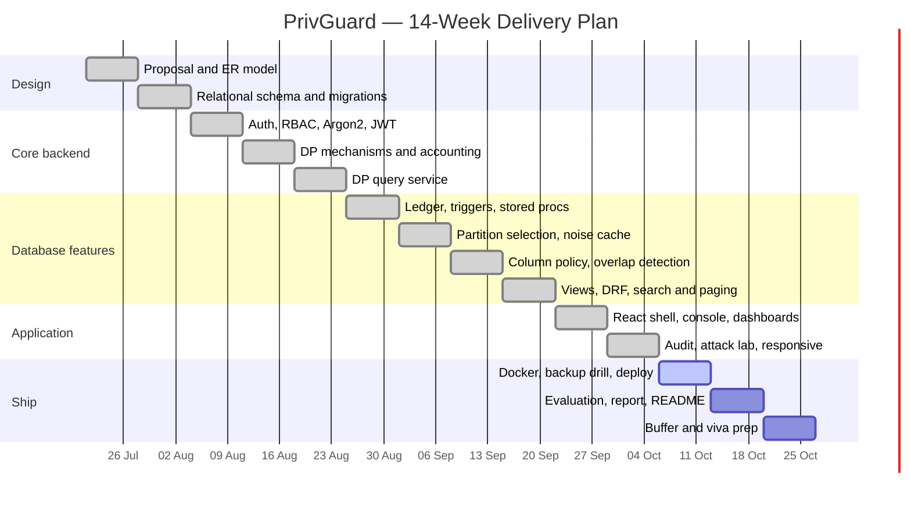

# PrivGuard — Project Proposal

**Course:** BCSE307L Database Systems · Fall Semester 2026–2027
**Faculty:** Dr. Deepika J
**Repository:** `github.com/ayush-kumar-21/privguard`

This document answers the eight items required by §2 *Project Planning* of the
project brief. Design detail lives in `PrivGuard_ER_Documentation.md`; the
mapping to the mark scheme lives in `PrivGuard_Rubric_Alignment.md`.

---

## 1. Project Title

**PrivGuard — A Differentially Private Query Gateway for Healthcare Analytics.**

## 2. Problem Statement

Hospitals hold data that is valuable in aggregate and dangerous in detail. A
research analyst has a legitimate need to ask *"what is the average length of
stay in cardiology?"* and no legitimate need to learn anything about any
individual patient. The usual answer — grant read access and trust the analyst
— fails in both directions: it over-trusts the analyst, and it still leaks,
because a sequence of innocuous aggregate queries can isolate a single record.

The leak is not hypothetical. Ask *"how many emergency visits?"* and then *"how
many emergency visits excluding patient X's ZIP code?"*, and the difference
between the two answers is a fact about one person. Adding noise to each answer
does not fix it either: ask the same question a thousand times, average the
answers, and independent noise cancels out.

PrivGuard is a web application over PostgreSQL in which **the system, not the
analyst, enforces privacy**. It answers aggregate SQL with calibrated
differential-privacy noise, charges every answer against a per-analyst privacy
budget recorded in an append-only hash-chained ledger, and refuses to serve an
analyst who has spent their allowance. Repeated questions return the *memoised*
answer at zero cost, so the averaging attack has nothing to average.

## 3. Objectives

1. Design a 3NF relational schema covering both the SafeHealth clinical dataset
   and the system catalog that governs it (30 entities, 42 relationships).
2. Implement a differentially private aggregate query service — Laplace,
   discrete Laplace and Gaussian mechanisms with clamping and contribution
   bounding — reached only through the Django ORM, never raw analyst SQL.
3. Enforce the privacy budget as **database state**: an append-only ledger whose
   integrity is guaranteed by triggers, and whose reserve/settle protocol runs
   as stored procedures inside a transaction.
4. Implement role-based access control over a single users table, with
   column-level policies down to per-role grants.
5. Deliver a responsive React application: dashboards, SQL console, CRUD
   screens, governance views, and an attack lab that demonstrates the
   averaging attack failing.
6. Ship it — Docker Compose, CI, database backup/restore drill, cloud deploy.

## 4. Scope

**In scope.** Aggregate queries (`COUNT`, `SUM`, `AVG`, optional `GROUP BY`)
over one privacy unit, `patients.patient_id`, on a star schema. Joins to public
dimension tables. Four roles, column-level policy, full audit trail.

**Out of scope.** Cross-privacy-unit joins, timing side channels, and a
malicious DBA — the DBA is inside the trust boundary. The from-scratch Rust
storage engine described in `privguard_blueprint.png` is **research work beyond
this course**, tracked separately in `IMPLEMENTATION_PLAN.md`; the graded build
is the Django + PostgreSQL + ORM application.

## 5. Team Members and Responsibilities

| Member | Area |
|---|---|
| **Sugesh Kumar** | Database design and hardening — schema, migrations, constraints, indexes, views, triggers and stored procedures; ledger integrity |
| **Ayush Kumar** | DP service layer — mechanisms, accounting, query rewriting, budget reserve/settle, attack lab |
| **Gouri Su** | React application — auth flows, dashboards, console, CRUD screens, responsive pass; Docker and CI |

> Adjust this table to match how the work actually divided before submission.

## 6. Technology Stack

| Layer | Choice | Why |
|---|---|---|
| Frontend | React 18 · Vite · TypeScript · TailwindCSS | Brief's recommended stack; TS catches API contract drift |
| Backend | Django + Django REST Framework | Brief's recommended pairing with the Django ORM |
| Database | PostgreSQL 16 | Required RDBMS; needed for `PL/pgSQL`, triggers, `BYTEA` |
| ORM | Django ORM | All data access; raw SQL only for procedures and triggers |
| Auth | DRF SimpleJWT | Access/refresh tokens with blacklist on logout |
| Hashing | Argon2 | Brief's recommended password hasher |
| DP layer | Python + NumPy/SciPy, `sqlglot` | `sqlglot` parses analyst SQL to an AST that is *never* re-emitted |
| Ops | Docker Compose · GitHub Actions | Reproducible local bring-up and CI on every push |

## 7. Major Deliverables

| # | Deliverable | Status |
|---|---|---|
| 1 | ER model — 30 entities, 42 relationships | Complete |
| 2 | 3NF relational schema, migrations, constraints, 144 indexes | Complete |
| 3 | Data dictionary | Complete (`PrivGuard_Data_Dictionary.md`) |
| 4 | DP query service with budget enforcement | Complete |
| 5 | Ledger: 3 triggers, stored procedures, 4 views | Complete |
| 6 | RBAC over a single users table + column policies | Complete |
| 7 | React application — 11 screens, responsive | Complete |
| 8 | Docker Compose + GitHub Actions CI | Complete |
| 9 | Backup/restore drill (`pg_dump` / `pg_restore`) | Complete (`db/`) |
| 10 | Cloud deployment + live URL | Outstanding |
| 11 | Final report and demo script | Outstanding |

## 8. Project Timeline

| Wk | Milestone |
|---|---|
| 1 | Proposal, ER finalised, synthetic SafeHealth generator, repo + CI skeleton |
| 2 | Django project, 28 models + migrations, admin CRUD, seed data |
| 3 | Auth: custom user (`sys_principal`), Argon2, JWT, RBAC permissions |
| 4 | DP library (Laplace / Gaussian / discrete Laplace), clamping, contribution bounds |
| 5 | DP query service: `sqlglot` parse → ORM aggregate → noise; COUNT/SUM/AVG |
| 6 | Budget: account + ledger models, **trigger** (hash chain), **stored procedure** (reserve), **transactions** |
| 7 | `GROUP BY` DP partition selection; noise memoisation (defeats the averaging attack) |
| 8 | Column policies (raw / dp / redacted / denied), predicate-overlap detection |
| 9 | **Views** (budget, audit, summary); DRF endpoints; search, filter, pagination |
| 10 | React: login, dashboard, SQL console, policy admin, CRUD screens |
| 11 | React: audit view, Attack Lab; validation, error handling, responsive pass |
| 12 | Docker Compose, Docker Hub, cloud deploy, custom domain, `pg_dump`/`pg_restore` drill |
| 13 | Evaluation (utility vs ε, attack resistance), report, README, demo script |
| 14 | Buffer, polish, viva preparation |
