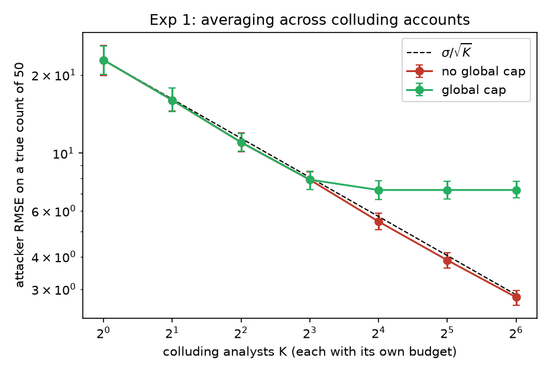
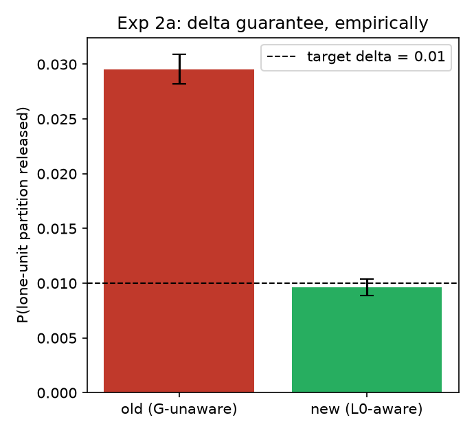
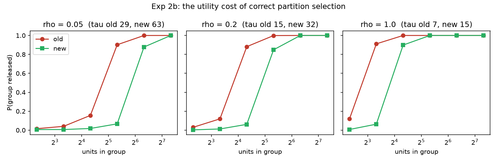
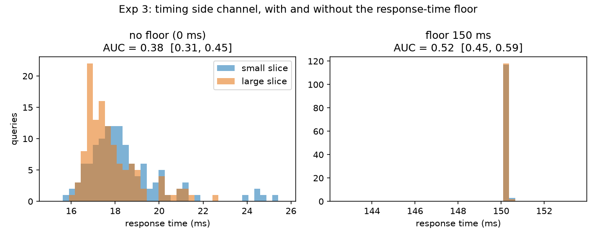

# Empirical evaluation of the DP hardening

`docs/DP_HARDENING.md` lists what was wrong and what changed. This document measures it: each
experiment compares the **old** behaviour with the **new** one, over repeated trials, with 95%
confidence intervals. Everything reproduces with Docker only:

```bash
./eval/run_all.sh        # a few minutes; figures land in docs/eval/
```

| Experiment | Question | Headline result |
|---|---|---|
| 0. Exact-count leak | Could an analyst read true counts? | Old: leaked field equalled the true count in 5/5 slices. New: field absent. |
| 1. Collusion | Does a global cap stop K colluding analysts averaging out the noise? | Without the cap RMSE keeps falling as 1/√K (22.8 → 2.8 at K=64). With it, RMSE floors at 7.2. |
| 2a. Partition δ | Does a lone unit's partition leak more than the stated δ? | Old: **3.0× the target δ**. New: 1.0×. |
| 2b. Partition utility | What does the correct fix cost? | Groups need roughly **2× as many units** to be released. |
| 3. Timing | Can an analyst tell a small slice from a large one by response time? | Without the floor: detectable (AUC 0.38, CI excludes 0.5). With it: not detectable (AUC 0.52). |
| 4. Direct database access | What can a holder of *database* credentials (or a backup) read? | Application role: everything. Analyst login: 9 of 11 attempts denied; only its own 500 query rows readable, another analyst's 2 rows invisible. Noise-seed replay: old storage recovers the true count exactly (40); new storage does not (44). |

## Experiment 0 — the exact-count leak

A one-off measurement made on the pre-fix code (seeded database, analyst `alice`, five narrow
slices, ρ = 0.05 per query). The leaked `rows_scanned` equalled the true count every time while the
DP answer was far off:

| Slice | DP answer | `rows_scanned` (leaked) | True COUNT |
|---|---|---|---|
| EMERGENCY / dept 1 | 54 | 31 | 31 |
| ELECTIVE / dept 5 | 51 | 34 | 34 |
| URGENT / dept 4 | 53 | 35 | 35 |
| EMERGENCY / dept 4 | 58 | 40 | 40 |
| EMERGENCY / dept 3 | 15 | 40 | 40 |

After the fix the analyst-visible fields of `/api/queries/` no longer include `rows_scanned` or
`latency_ms`; this is pinned by `tests/test_dp_hardening.py::TestOutputChannels`. (The pre-fix run is
not re-runnable from this repository because it required the old code.)

## Experiment 1 — collusion and the global cap

K analysts, each with their own budget (ρ = 0.05) and therefore independent noise, ask the same
COUNT (true value 50, contribution bound 5) and average the answers. 400 trials per point; error
bars are bootstrap 95% intervals on the RMSE. The cap models `rho_global_cap` = 0.5, i.e. room for
10 accounts.



Without a cap the attacker's RMSE follows σ/√K: 22.8 (K=1) → 11.0 (K=4) → 5.5 (K=16) → 2.8
(K=64). With the cap the attacker is cut off at 10 accounts and RMSE floors at ≈7.2 whatever K is.

*What this shows:* the cap converts "leakage grows without bound with the number of accounts" into
a fixed ceiling. *What it does not show:* that 0.5 is the right cap — that is a policy choice.
The cap's enforcement inside `sp_reserve_budget` (including the race on the database row lock) is
tested separately in `TestGlobalBudgetCap`; this experiment models its consequence.

## Experiment 2 — partition selection

The old code noised each GROUP BY partition as if a unit influenced only one. A unit appears in up
to G = 3 partitions, so the real cost was higher than charged.

### 2a. The δ guarantee, empirically

A partition containing exactly one unit must be released with probability ≤ δ = 0.01 even though
that unit sits in G = 3 partitions. 60,000 trials each (old parameters reproduced from the previous
code in `eval/exp_collusion_and_partition.py::legacy_params`):

| | P(lone unit released) | 95% CI | × target |
|---|---|---|---|
| old (G-unaware) | 0.0295 | [0.0282, 0.0309] | **3.0×** |
| new (L0-aware) | 0.0096 | [0.0089, 0.0104] | 1.0× |



The old scheme's per-unit privacy loss was also G× the claimed value (ε ≈ 0.42 vs 0.14; zCDP cost
0.030 vs 0.010 for the partition stage). The measured 3.0× matches the analytic prediction
(1−(1−δ)^G ≈ Gδ), which is the evidence that the diagnosis is right and not just plausible.

### 2b. The utility cost of being correct



At ρ = 0.2 a group of 20 units was released 88% of the time before and 6% now; a group of 40 is
released 100% before and 85% now. Correct accounting needs a threshold roughly twice as high, so
small groups disappear sooner. This is the honest price of the guarantee, and it is why the demo's
grouped queries need a larger ρ than before.

## Experiment 3 — timing

An analyst issues 120 fresh COUNT queries against a small slice (true count ≈ 30) and 120 against
a large one (≈ all rows), timing each call end to end (gateway plus PostgreSQL). Distinguishing
power is the AUC of "small vs large": 0.5 is no information.

| Setting | small median | large median | AUC | 95% CI | Verdict |
|---|---|---|---|---|---|
| no floor | 18.0 ms | 17.5 ms | 0.381 | [0.307, 0.448] | **detectable** (CI excludes 0.5) |
| 150 ms floor | 150.2 ms | 150.2 ms | 0.520 | [0.447, 0.589] | not detectable |



Timing varies between runs (the figures above are from one run; the verdicts — detectable without the
floor, not with it — held on every run we made).

*Reading this honestly:* the leak is real but small — the medians differ by half a millisecond, and
the larger slice was actually slightly *faster*, so the direction is not what one would guess. It
is nonetheless statistically significant with only 120 samples per class, and an attacker with more
samples would do better. The floor removes it at the cost of a fixed 150 ms per query.

## Experiment 4 — direct database access

Everything above goes through the API. This asks what someone with the *database* can do: a stolen
connection string, a restored backup, an analyst-facing BI connection.

### 4A. The same attempts as the application role and as an analyst login

Seeded database; `alice` logs in as `analyst_<her id>` (a member of `privguard_analyst`); `frank`
has two queries of his own so row-level isolation is exercised.

| Attempt | Application role | Analyst login |
|---|---|---|
| read raw patients (incl. `mrn`) | allowed | **denied** |
| read raw visits | allowed | **denied** |
| read exact per-department aggregates (`v_visit_summary`) | allowed | **denied** |
| read cached answers + seed material (`sys_noise_cache`) | allowed | **denied** |
| read the budget ledger | allowed | **denied** |
| read the user table (password hashes) | allowed | **denied** |
| read the timing column of `sys_query` | allowed | **denied** |
| read own query history | 502 rows (everyone's) | 500 rows (own only) |
| read another analyst's query history | 2 rows | **0 rows** |
| grant self more budget (`UPDATE`) | allowed | **denied** |
| `CALL sp_refill_budget` | allowed | **denied** |

(The application role is the table owner, which PostgreSQL exempts from row-level security; the
point of the column is the contrast, not that the owner is "wrong" to read its own data.)

### 4B. The noise-seed replay attack

The attacker reads the seed from `sys_noise_cache`, replays the noise and subtracts it from the DP
answer they were given.

| | Value |
|---|---|
| ground-truth count | 40 |
| DP answer given to the analyst | 25 |
| attacker, **old** storage (raw seed in the table) | recovers **40 — exact** |
| attacker, **new** storage (commitment only) | recovers 44 — wrong |

The same replay works with *no database access at all* if the server secret is the public default
(finding 10 in `DP_HARDENING.md`), which is why the app now refuses to start in production with one.

## Limitations of the evaluation

* Experiments 1 and 2 sample the real noise code with synthetic seeds; they do not go through the
  HTTP API. Experiment 3 does go through the gateway and database but in-process, so network
  jitter that would hide small differences in a real deployment is absent (this makes the attack
  look *stronger* than it would be remotely).
* Experiment 4 is a single run on one slice, not a statistical estimate: the outcomes are
  deterministic (a permission is granted or it is not; a seed replays exactly or it does not), so
  repeating it would add nothing. It does not test a managed database that forbids `CREATE ROLE`
  (the role is then simply absent).
* The floating-point attack of Mironov / Jin et al. is **not** measured: the old samplers were
  replaced on the strength of the published analysis, not a demonstrated exploit here.
* One true count, one ρ and one G per experiment; the shapes are what matter, not the constants.
